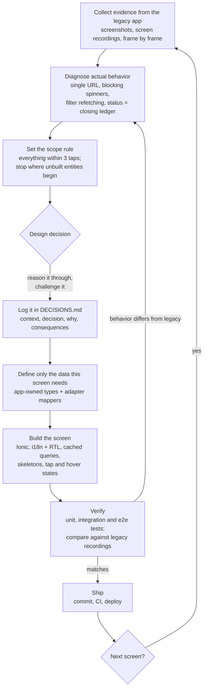
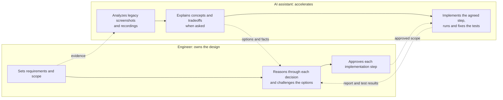
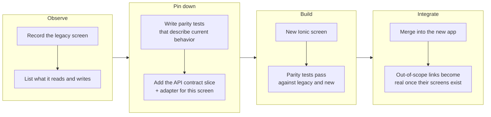
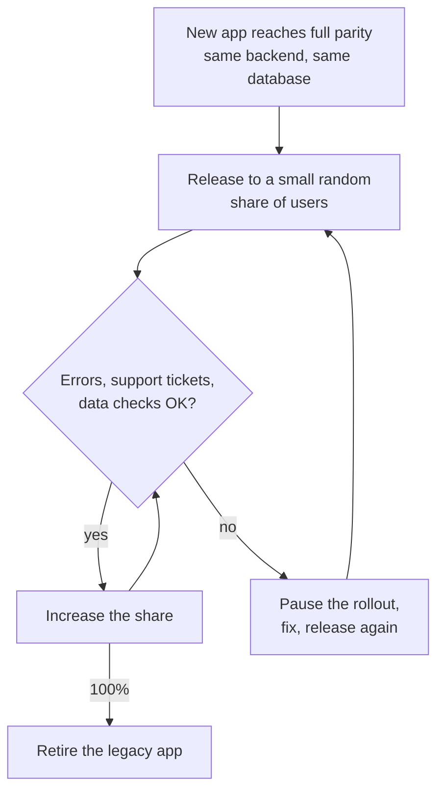

# Migrating the legacy app, screen by screen

This repository rebuilt two areas of the legacy Cordova + Angular app: Home, and History with everything up to three taps away. This document turns how that was done into a repeatable process for the rest of the app.

## 1. How this rebuild was done

### Working with AI

This rebuild was done with an AI coding assistant (Claude Code) as a pair programmer, and the migration plans to keep working that way. The split of responsibility:

- Every architecture decision is made and justified by the engineer, then logged in [DECISIONS.md](DECISIONS.md).
- The AI implements only the scope that was approved, and reports what it changed and how it was verified.
- Tests are the safety net for both: nothing ships on "looks right".

## 2. One iteration per screen

The new Ionic + React app is built in full alongside the legacy one, against the same backend and database. Each iteration adds one screen or entity to it:

What makes each iteration safe:
- **The adapter seam** ([DECISIONS.md #8](DECISIONS.md)): screens use the app's own types. Each screen adds only the slice of the real API it needs, so nobody has to model the whole legacy data first (#6).
- **Parity tests**: they describe what the legacy screen does today, and pass against both versions before users are switched over.
- **The scope rule** (#2): an iteration stops where it would need entities that haven't been migrated yet; those actions show a work-in-progress notice.

## 3. Switching users to the new app

Users stay on the legacy app until the new app covers it completely. Then they're moved over **gradually**, never all at once:

**Why gradual:** with an all-at-once switch, every problem in the new app hits every client at the same moment, and problems pile up on each other. A small, random share of users surfaces problems while they still affect few clients, and keeps going back possible.

**Release mechanics to plan for:**
- **Same app identity:** the new app must ship under the legacy app's app ID and signing key, so stores and phones treat it as an update, not as a second app.
- **Mobile rollout:** Google Play's staged rollout and the App Store's phased release roll out to a growing percentage and can be paused. An installed version can't be pulled back: going back means releasing the previous code under a higher version number.
- **The web/PWA version** can be switched per user on the server, which also allows an A/B comparison.
- **Data stored on the device:** Cordova and Capacitor serve the app from different origins, so anything the legacy app kept in local storage (e.g. a login session) doesn't carry over automatically and needs a migration step.

## 4. Choosing the next screen

History was the starting point because it was the assignment. For the rest of the app:

1. **Start with the least connected entities**, the ones that can be built in isolation. They're the quickest small wins, and they establish the app's structure, conventions and UI building blocks early.
2. **Build up from there** toward the entities that depend on them. Each one reuses the structure and adapters already in place.
3. **Leave the most interconnected entities for last.** By then, the entities they depend on already exist in the new app.

## 5. What "same behavior" means

**Must stay identical:** the data. That means the same data schemas, the same data flow, and the same links between tables. A migrated screen reads and writes exactly what the legacy screen did, through the same backend. The backend is not being changed.

**May improve, moderately:** the user experience, wherever it comes from the old implementation and not from the business rules:
- Data that hasn't changed isn't refetched on every navigation or tap. Caching with TanStack Query ([DECISIONS.md #4](DECISIONS.md)) replaces the legacy blocking reloads.
- Content-shaped skeletons replace blocking spinners (#3).
- Real routes with a working back button (#1).

**Not a goal yet:** a visual redesign. The first goal is rewriting in current best practices and conventions. Visual changes stay modest, and a redesign is a separate decision for later, if the business wants one.

## 6. Working with the junior developer

Both developers own the **whole** flow of migrating a screen, from observing the legacy screen to shipping it. The junior isn't limited to either the routine work or the interesting work.

- The work is split by **screens or entities**: each developer migrates different ones in parallel.
- Where their work meets (shared entities, shared components, the adapter layer), the two decide together, case by case, who owns what.

## 7. Definition of done for a screen

A screen is migrated when:
- [ ] Its parity tests pass against the legacy and the new version: same data read and written, same links between records.
- [ ] It works in Hebrew, English and Spanish, right-to-left and left-to-right.
- [ ] It has its own route: the back button and deep links work.
- [ ] Loading shows content-shaped skeletons and never blocks the screen; returning to it uses the cache.
- [ ] Every write refreshes the cached data it affects.
- [ ] Architecture decisions are logged in DECISIONS.md.
- [ ] CI is green, including end-to-end tests.
