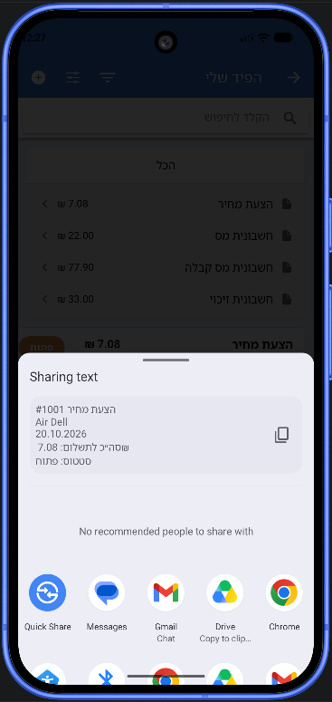
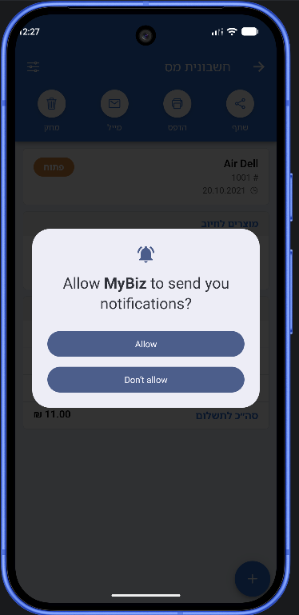
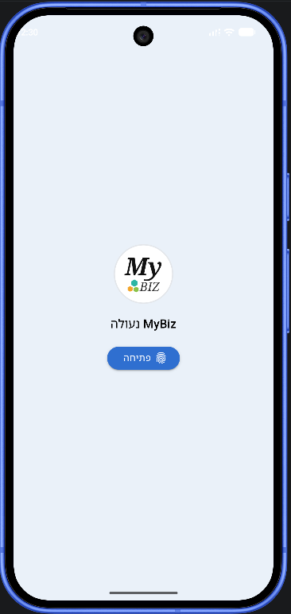
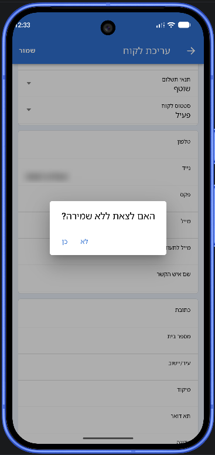

# MyBiz: Ionic rebuild

A rebuild of the MyBiz bookkeeping app's Home and History screens in **Ionic + React + TypeScript**. One codebase ships as a web app / PWA and as native Android and iOS apps (Capacitor). Hebrew, English and Spanish are supported, with right-to-left and left-to-right layouts.

- **Home**: a UI replica. History is the only working button; every other action shows a "work in progress" alert.
- **History** (functional, plus everything within 3 taps of it):
  - a document feed with search, per-type totals and type filtering
  - document details
  - status: closing documents against each other, or manually
  - closing other documents
  - cancel and delete
  - the client card: details, the client's documents, the bookkeeping ledger, and editing
  - Excel export (plain, or detailed with due dates and recipients)

Architecture decisions and the reasoning behind them are in **[DECISIONS.md](DECISIONS.md)**. How the same process would migrate the rest of the legacy app, screen by screen, is in **[MIGRATION.md](MIGRATION.md)**.

## Repository layout

```
web/   Ionic React app (Vite, Capacitor) – deployed to Netlify
api/   Mock bookkeeping API (Express, Postgres on Supabase) – deployed to Render
```

Inside `web/src`:
- `domain/`: the app's own types
- `api/`: the adapter layer that maps API shapes to and from those types
- `features/`: screens
- `i18n/`: translations

## Run locally

Requires Node 22.

```bash
npm install
cp api/.env.example api/.env   # then paste the DATABASE_URL you were given
npm run dev                    # API on http://localhost:3001, app on http://localhost:8100
```

Open http://localhost:8100. To reset the demo data at any time, run `npm run db:seed -w api`.

## Tests

```bash
npm test                       # web unit tests
npm test -w api                # API route tests
npm run test.e2e -w web        # Cypress end-to-end (needs `npm run dev`; resets the demo data)
```

The API's Postgres integration tests run when `TEST_DATABASE_URL` points to a disposable database. See the header of `api/src/documents/repository.int.test.ts` for a one-line Docker command.

## Android

The native Android project is in `web/android` (app ID `io.github.roni750.masaditdemo`).

**Install it without building anything:** every push builds a debug APK in GitHub Actions. Open the latest **Android APK** run, download `mybiz-debug-apk` under *Artifacts*, copy `app-debug.apk` to an Android phone and open it. The APK talks to the API at the repository variable `VITE_API_URL`.

**Build it yourself** (requires [Android Studio](https://developer.android.com/studio)):

```bash
cd web
echo VITE_API_URL=https://<your-api>.onrender.com > .env.production.local   # the phone can't reach localhost
npm run android:sync           # builds the web app and copies it into the Android project
npm run android:open           # opens Android Studio: Run ▶ on a device or emulator, or Build → Generate APKs
```

App icons and the splash screen are generated from `web/public/logo.svg`: `web/assets/logo.png` is the source, and `npm run assets:generate` rebuilds them. The installable web version (PWA) gets its icons from the same SVG at build time.

### Native features, running on Android

Screenshots from the Android build running on a Pixel 10 emulator (Android 17), against the deployed API. Each feature goes through Capacitor's native plugins, not a web imitation.

| | |
|:---:|:---:|
|  |  |
| **Native share sheet.** Swiping a History card (here a price quote) and tapping *Share* opens Android's own share sheet with a readable summary of the document: type and number, client, date, total and status. Ready for WhatsApp, Gmail, Drive and so on. | **Due-date reminders.** On an open tax invoice, *Remind me on the due date* first asks for Android's notification permission. The reminder is then scheduled on the device for 09:00 on the due date, worked out from the client's payment terms. Tapping the notification opens that invoice. |
|  |  |
| **Biometric app lock.** On a device with a screen lock, financial data stays behind the fingerprint, face unlock or device PIN. The lock appears when the app starts or returns after more than a minute in the background. | **Unsaved changes guard.** Editing a client and pressing Android's **system back gesture** asks *"Leave without saving?"* before discarding the change, the same as the toolbar's back arrow. The app hooks into Android's hardware back button, so the native gesture can't bypass the guard. |

## Deployment

- **Web (Netlify):** configured by `netlify.toml`. Set the `VITE_API_URL` environment variable to the API's URL.
- **API (Render):** configured by `render.yaml`. Set `DATABASE_URL` (Supabase session pooler) and `CORS_ORIGINS` (the Netlify site URL).
- **Database:** `npm run db:migrate -w api`, then `npm run db:seed -w api`.
